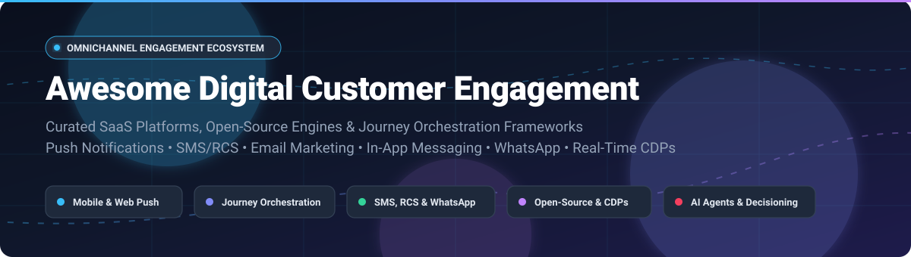

# 🚀 Awesome Digital Customer Engagement

  

  <strong>Curated ecosystem of SaaS platforms, open-source software, customer journey builders, and messaging infrastructure.</strong> 
  <em>Supercharge omnichannel marketing, behavior-triggered push notifications, SMS/RCS, conversational AI, in-app messaging, and customer data platforms (CDP).</em>

---

## 📌 Table of Contents

- [🌐 Sector Overview & Market Dynamics](#-sector-overview--market-dynamics)
- [🏢 SaaS / Hosted Platforms](#-saas--hosted-platforms)
- [💻 Open-Source GitHub Projects](#-open-source-github-projects)
- [🛠️ Frameworks for Building Custom Stacks](#️-frameworks-for-building-custom-stacks)
- [📈 Star History](#-star-history)
- [🤝 How to Contribute](#-how-to-contribute)
- [💖 Support](#-support)
- [⚖️ Disclaimer](#️-disclaimer)

---

## 🌐 Sector Overview & Market Dynamics

The global **digital customer engagement solutions market** is estimated at approximately **$25 billion to over $40 billion** and is projected to expand at a compound annual growth rate (CAGR) of **9% to 11% through 2030**. This growth is propelled by enterprise investments in cloud infrastructures, omnichannel cross-device orchestration, and generative AI agent deployments (such as automated customer decisioning and conversational bots).

The sector exhibits a **moderately fragmented** competitive landscape:
- **Top Enterprise Tier**: Megavendors such as Salesforce, Adobe, and Oracle capture significant enterprise market share through unified CRM suites and cloud service offerings.
- **Dynamic Best-of-Breed & Modern Contenders**: Far from being a winner-take-all ecosystem, high-growth contenders (e.g., Braze, Klaviyo, Iterable, CleverTap, MoEngage) maintain distinct differentiation through developer-first agility, mobile SDK maturity, and hyper-personalized real-time messaging.
- **Open-Source & Self-Hosted Wave**: Data privacy mandates (GDPR, HIPAA, CCPA) and volume-based pricing have driven a burgeoning wave of open-source engines and headless infrastructure (Novu, Chatwoot, Dittofeed, Mautic, Laudspeaker), enabling engineering teams to maintain total sovereignty over their customer event pipelines.

---

## 🏢 SaaS / Hosted Platforms

| Platform | Company Size (Valuation / Revenue) | Starting Tier Pricing | Free Tier / Trial Limits | Description |
| :--- | :--- | :--- | :--- | :--- |
| **[Salesforce Digital Engagement](https://www.salesforce.com/service/digital-customer-engagement-platform/)** | **~$250B+ Market Cap** (~$37.9B FY25 Revenue) | $75 / user / month (Service Cloud add-on, billed annually) | 30-day free trial (Service Cloud trial environment) | Service Cloud add-on connecting businesses across SMS, WhatsApp, Messenger, Apple Messages, LINE, and web chat. Features Agentforce AI agents, mass SMS, and real-time resolution dashboards. |
| **[Klaviyo](https://www.klaviyo.com/)** | **~$5B–$10B Market Cap** (~$1.23B FY25 Revenue) | $20 / month (Email plan starting up to 500 active profiles) | Free forever plan: Up to 250 active profiles, 500 monthly email sends, and 150 SMS/MMS credits | E-commerce marketing automation platform with built-in CDP. Features omnichannel flows across email, SMS/MMS, mobile push, WhatsApp, 350+ integrations, and Klaviyo AI. |
| **[Braze](https://www.braze.com/)** | **~$3.2B Market Cap** (~$593M FY25 Revenue) | ~$2,500 / month (Entry-level contracts typically start at ~$30,000/yr for ~50k MAUs) | 14-day free trial (interactive sandbox and feature tour; no permanent free tier) | Customer engagement platform for cross-channel messaging with Canvas journey builder. Features BrazeAI Decisioning Studio, SQL Query Builder with AI assistant, and connected content. |
| **[Iterable](https://iterable.com/)** | **~$2.0B Valuation** (~$240M ARR) | ~$3,000 / month (Standard entry Growth tiers start at ~$36,000/yr for ~10k–50k MAUs) | No permanent free plan; customized 14-day sales-assisted demo/PoC sandbox upon request | Cross-channel growth marketing platform with Studio drag-and-drop campaign builder, journey logic, webhooks for BI/Zapier/Twilio integration, and real-time editing. |
| **[MoEngage](https://www.moengage.com/)** | **~$850M–$900M Valuation** (~$100M+ ARR) | $750 / month (Starter/Growth plan for up to 10k–25k MAUs) | No permanent free plan; 14-day customized Proof-of-Concept (PoC) / guided trial via sales demo | Insights-led customer engagement platform. Features Merlin AI for send-time optimization and predictive segments, cross-channel campaigns, Flows with conditional logic, and automated offer decisioning. |
| **[CleverTap](https://clevertap.com/)** | **~$775M Valuation** (~$100M+ ARR) | $75 / month (Core Essentials plan starting at up to 5,000 MAUs) | 30-day free trial (Core plan features up to 5,000 MAUs and 600 CleverAI tokens) | Customer engagement and retention platform combining app analytics with marketing. Features funnels, cohorts, 13 messaging channels, and Journeys visual builder. |
| **[Customer.io](https://customer.io/)** | **~$690M Valuation** (~$100M ARR) | $100 / month (Essentials plan starting at up to 5,000 profiles & 1M emails/mo) | 14-day free trial (capped at 50 test email sends/day; no permanent free tier) | Behavioral messaging platform for product-led growth. Features event-triggered automations across push, in-app, SMS, email, and webhooks with mobile SDKs. |
| **[Airship](https://www.airship.com/)** | **~$100M+ Total Funding** (~$55M–$60M Revenue) | ~$1,000 / month (Essentials entry tier starting at ~$12,000/yr based on MAUs) | No permanent free plan; pilot / Proof-of-Concept (PoC) trial period via sales evaluation | Enterprise mobile customer engagement specializing in push notifications, in-app messaging, SMS/RCS, email, and Mobile Wallet passes. |
| **[OneSignal](https://onesignal.com/)** | **~$20M–$50M Revenue** (Series C funded) | $19 / month (Growth plan base fee + usage) | Free forever plan: Up to 1,000 mobile MAUs, 10,000 web push subscribers, and 10,000 emails/month | Push notification and customer engagement platform. Supports mobile push, web push, in-app messages, email, SMS, and Live Activities with multi-step Journeys. |
| **[Pushwoosh](https://www.pushwoosh.com/)** | **~$10M–$13M Revenue** (Bootstrapped/Private) | $7 / 1,000 MAU (Push Only) or $13 / 1,000 MAU (Omnichannel) | Free forever plan: Up to 1,000 MAUs, unlimited push & in-app impressions, and 20,000 email sends/month | Customer engagement platform with WooCommerce integration, Customer Journeys, web push, abandoned cart recovery, and order event tracking. |

---

## 💻 Open-Source GitHub Projects

Curated open-source repositories for self-hosted customer engagement, workflow orchestration, in-app communication, and messaging infrastructure. Sorted in descending order by GitHub_Stars.

| Repository | GitHub_Stars | License | Primary Focus |
| :--- | :--- | :--- | :--- |
| **[n8n](https://github.com/n8n-io/n8n)** |  | Sustainable | Workflow automation engine with extensive integrations for triggering customer lifecycle messaging, webhooks, and transactional flows. |
| **[Novu](https://github.com/novuhq/novu)** |  | Apache-2.0 | Open-source notification infrastructure and centralized API for managing transactional and engagement notifications across push, email, SMS, and in-app feeds. |
| **[Chatwoot](https://github.com/chatwoot/chatwoot)** |  | AGPL-3.0 | Omnichannel customer communication & engagement suite (alternative to Intercom and Zendesk) connecting live chat, WhatsApp, Twitter, and email. |
| **[Listmonk](https://github.com/knadh/listmonk)** |  | AGPL-3.0 | High-performance, self-hosted newsletter and customer mailing list manager packed into a single Go binary with multi-million message throughput. |
| **[Formbricks](https://github.com/formbricks/formbricks)** |  | AGPL-3.0 | Privacy-first micro-survey and in-app customer feedback platform for triggering contextual surveys at key points in the user journey. |
| **[Mautic](https://github.com/mautic/mautic)** |  | GPL-3.0 | Fully featured open-source marketing automation suite supporting email, SMS, social channels, complex lead nurturing workflows, and segmentation. |
| **[Papercups](https://github.com/papercups-io/papercups)** |  | MIT | Open-source live customer messaging platform with React chat widgets, Slack sync, and conversational customer support integrations. |
| **[Jitsu](https://github.com/jitsucom/jitsu)** |  | MIT | Open-source event collection engine and data pipeline capturing behavioral customer actions and streaming them to destinations and data warehouses. |
| **[RudderStack](https://github.com/rudderlabs/rudder-server)** |  | AGPL-3.0 | Warehouse-first Customer Data Platform (CDP) core pipeline for collecting, routing, and activating behavioral customer event streams. |
| **[Dittofeed](https://github.com/dittofeed/dittofeed)** |  | MIT | Developer-friendly engagement engine (Customer.io alternative) with visual journey builders, segmentation, Git-backed workflows, and multi-channel delivery. |
| **[Laudspeaker](https://github.com/laudspeaker/laudspeaker)** |  | AGPL-3.0 | Open-source journey orchestration engine (Braze/Iterable alternative) triggering real-time cross-channel messages (email, SMS, push) from user event streams. |
| **[Metarank](https://github.com/metarank/metarank)** |  | Apache-2.0 | Real-time personalization and machine-learning ranking engine providing personalized recommendation rails and search boosts for customer journeys. |
| **[Apache Unomi](https://github.com/apache/unomi)** |  | Apache-2.0 | Reference Customer Data Platform (OASIS CDP specification) providing unified profile management, behavioral rule engines, and privacy compliance. |
| **[Fusion](https://github.com/fusion-hq/fusion)** |  | Apache-2.0 | All-in-one product analytics and user engagement platform combining event tracking, user flows, live chat, and automated targeted notifications. |
| **[OpenClix](https://github.com/OpenClix/openclix)** |  | MIT | Config-driven on-device mobile app retention engine keeping evaluation logic inside app codebases across iOS (Swift), Android (Kotlin), Flutter, and React Native. |
| **[Helio](https://github.com/achref-soua/helio)** |  | AGPL-3.0 | AI-native customer growth platform built on Temporal workflow engine, unifying predictive segmentation, LLM brand voice generation, and cross-channel journeys. |
| **[MessageBirds](https://github.com/Mullassery/MessageBirds)** |  | MIT | Event-driven customer data and engagement framework written in Rust & TypeScript featuring durable customer journeys, identity resolution, and edge ingestion. |

---

## 🛠️ Frameworks for Building Custom Stacks

For growth engineering teams seeking complete data sovereignty and avoiding escalating volume fees:
- **Orchestration & Journeys**: Deploy **[Dittofeed](https://github.com/dittofeed/dittofeed)** or **[Laudspeaker](https://github.com/laudspeaker/laudspeaker)** as your primary visual journey engine.
- **Notification Routing**: Route transactional and engagement alerts across email, push, SMS, and in-app feeds via **[Novu](https://github.com/novuhq/novu)**.
- **Conversational Support & Live Chat**: Integrate **[Chatwoot](https://github.com/chatwoot/chatwoot)** or **[Papercups](https://github.com/papercups-io/papercups)** to bridge interactive messaging channels (WhatsApp, live chat, email).
- **Data Ingestion & CDP Pipeline**: Ingest and route behavioral events through **[RudderStack](https://github.com/rudderlabs/rudder-server)** or **[Jitsu](https://github.com/jitsucom/jitsu)** connected to PostgreSQL and ClickHouse.
- **AI-Native Segmentation & Recommendations**: Layer **[Helio](https://github.com/achref-soua/helio)** for predictive LLM segment generation and **[Metarank](https://github.com/metarank/metarank)** for personalized recommendations.

---

## 📈 Star History

---

## 🤝 How to Contribute

Contributions are warmly encouraged! Help us keep this directory accurate, up-to-date, and comprehensive:

1. 🍴 **Fork the repo** to your GitHub account.
2. 🌿 **Create a new branch** (`git checkout -b feature/add-new-platform`).
3. 📝 **Add or update entries** in `README.md` (keep descriptions concise, objective, and include official links, pricing, or Stars_Badges).
4. 🚀 **Commit your changes** (`git commit -m "feat: add platform xyz"`).
5. 📬 **Open a Pull Request** with a brief summary of what you've added or changed.

⭐ **If you find this repository valuable, please consider giving it a star!**

---

## 💖 Support

Thank you for exploring and supporting this curated catalog of digital customer engagement software! Building and maintaining quality developer-centric resources takes continuous research and care.

If you find this project useful for your engineering, marketing, or product stack:
- ⭐ **Star this repository** to help others discover it.
- 🍴 **Fork and contribute** new tools or updates.
- 📢 **Share it** on LinkedIn, X/Twitter, or Reddit.
- ☕ **Buy me a coffee / Become a sponsor**: If you would like to support ongoing development and curated open-source research, consider supporting via the [GitHub Sponsors Dashboard](https://github.com/sponsors/ishandutta2007).

---

## ⚖️ Disclaimer

- This list is **community-curated** for educational and architectural evaluation purposes — inclusion does not imply official endorsement.
- Digital engagement platforms processing user information must comply with applicable privacy laws (including GDPR, CCPA, and CAN-SPAM).
- Organizations self-hosting open-source customer communication platforms should ensure proper TLS encryption, secret management, deliverability configurations (SPF, DKIM, DMARC), and routine infrastructure maintenance.

  Made with ❤️ for growth engineers, CRM specialists, product managers, and developers building the future of customer engagement.

